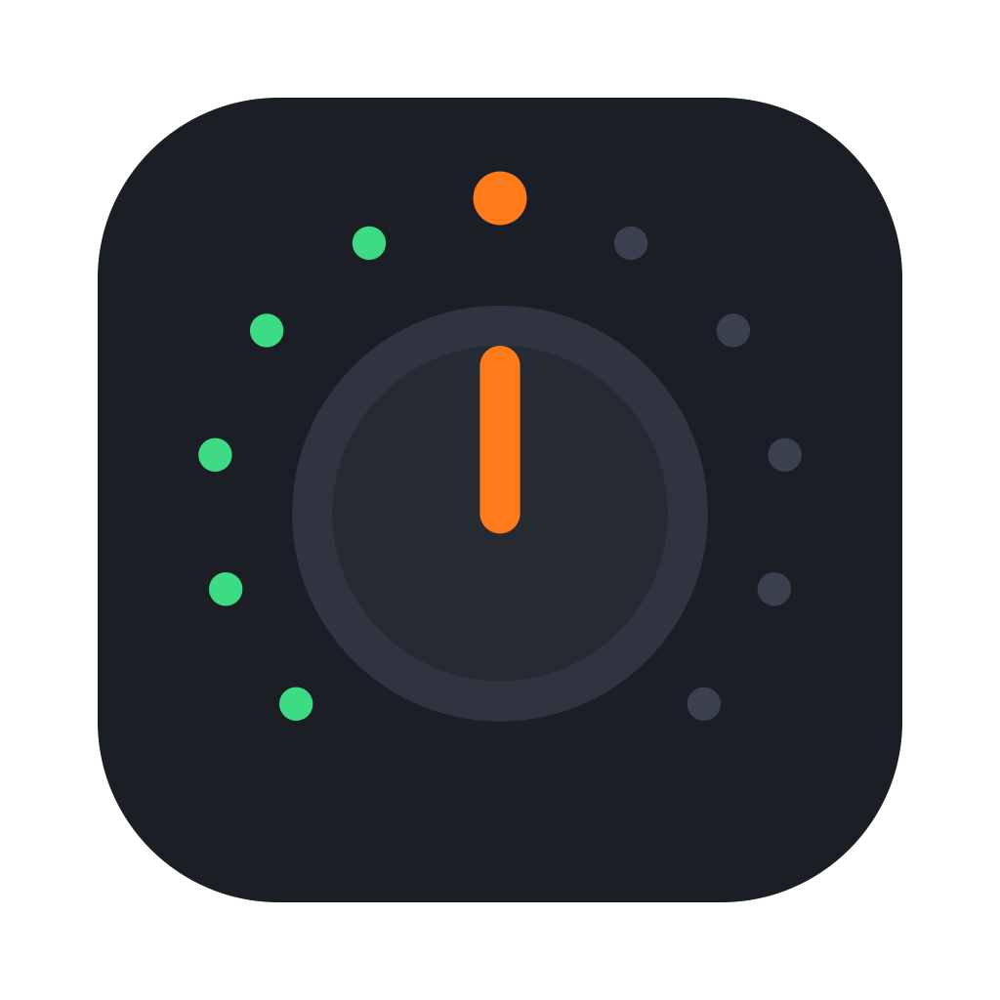

# StageRack

> **Beta 0.6.0** — versione di prova. Usala in prova prima di portarla su un palco vero.

**Novità 0.6:** EverClean (Everworks, gratuito) ottimizzato come De-Feedback: si accende da solo quando lo inserisci, i suoi hop vengono distribuiti, e un **controllo continuo degli hop** ri-distribuisce dal vivo, senza click, qualsiasi plugin a blocchi che venga acceso o tolto dal bypass dopo. Il core wake assist ora si attiva solo per i plugin che ne hanno bisogno. Misure con audio reale: [De-Feedback contro EverClean](#de-feedback-contro-everclean-con-audio-reale).

Host di plugin per l'audio dal vivo, per macOS 11 (Big Sur) o successivo, su **tutti i Mac**: app universale, nativa sia su Apple Silicon (M1…M4) sia su Intel. L'impostazione è quella di Waves SuperRack Performer (rack, scene, interfaccia scura), con alcune idee prese da LiveProfessor.

## Formati supportati
| Formato | Stato |
|---|---|
| AU (AudioUnit v2/v3) | ✅ |
| VST3 | ✅ |
| CLAP | ✅ host scritto da zero (`Source/Plugins/CLAPPluginFormat.mm`): JUCE non sa ospitare plugin CLAP |
| LV2 | ✅ |
| VST2 | ⚙️ opzionale: Steinberg non distribuisce più l'SDK VST2, quindi va aggiunto a mano (vedi sotto) |

## Multicore
- Ogni **rack** è una catena di 8 slot in serie. I rack sono indipendenti tra loro, quindi vengono **elaborati in parallelo**.
- `WorkerPool`: thread realtime (time-constraint) agganciati all'**Audio Workgroup di CoreAudio**, così macOS li tiene sui **P-core** dell'M4 Pro insieme al thread dell'interfaccia audio. Di default usa un thread per P-core.
- Il percorso audio non usa lock né allocazioni: il lavoro viene distribuito tramite un unico atomico a 64 bit.
- **Adattivo**: se il carico è basso resta su un solo core (svegliare i thread costa più di quanto si guadagna) e passa al multicore quando il *picco* recente lo giustifica. Da fermo i thread dormono e il consumo di CPU è circa 0%.
- Nella barra in alto c'è un meter per ogni thread; ogni rack mostra il core su cui gira, la sua CPU e la latenza.

Benchmark su M4 Pro, 128 campioni @ 48 kHz:
```
soothe2 ×16 (8 rack):        1 thread 0.38 ms (worst 1.61)  →  8 thread 0.074 ms (worst 0.44)   x5.1
Supermassive ×24 (12 rack):  1 thread 0.25 ms               →  8 thread 0.059 ms                 x4.2
```
Per ripeterlo:
```bash
build/StageRack_artefacts/Release/StageRack.app/Contents/MacOS/StageRack --bench VST3 "/Library/Audio/Plug-Ins/VST3/soothe2.vst3" 8 128
```

## Plugin pesanti a latenza zero (De-Feedback, EverClean, ...)
StageRack non ha impostazioni scritte per un plugin specifico: **misura ogni plugin** che inserisci (tempo di ogni chiamata, regolarità dei picchi, attesa di thread interni) e si adatta. I plugin a costo costante (EQ, compressori...) non vengono toccati. L'unica regola fissa è accendere *Active* su EverClean all'inserimento, perché spento non fa nulla.

### Come lavora De-Feedback (misurato)
- Esegue la sua rete neurale una volta ogni **192 campioni** (un "hop"). In quel callback spende 0.2-0.7 ms; negli altri quasi niente (~0.02 ms).
- Ogni istanza crea 2 thread propri e usa il BLAS di Accelerate. Il thread audio esegue gran parte del calcolo dell'hop.
- Senza accorgimenti, tutte le istanze fanno l'hop **nello stesso callback**: 8 istanze = 8 hop insieme = callback persi, anche con tutti i core.

### Cosa fa StageRack (senza aggiungere latenza)
1. **Spread degli hop** (SETTINGS, attivo di default). Quando un plugin viene inserito o la scheda riparte, StageRack ne misura il costo chiamata per chiamata, riconosce l'hop e gli fa processare qualche blocco di silenzio una volta sola, così il suo hop cade nella fase di callback meno occupata. Il tempo di uscita del plugin non cambia: la latenza resta 0.
   **Controllo continuo degli hop**: durante lo show StageRack registra in quali callback ogni plugin ha davvero l'hop e lo confronta con dove l'aveva messo (2 volte al secondo, costo trascurabile). Se un hop compare o si sposta (plugin acceso dopo, come EverClean con *Active*, rack o slot tolto dal bypass, stato richiamato da una scena) e finisce in un callback già occupato mentre una fase più libera esiste, quel plugin viene ri-distribuito **dal vivo** con lo stesso passaggio senza interruzioni del Re-spread (gemello + crossfade, sotto). Un hop sparito da 1 s (plugin spento) libera la sua fase.
2. **Core wake assist** (SETTINGS, Auto di default). A ogni hop De-Feedback sveglia un proprio helper interno e lo aspetta. Con poche istanze i P-core sono in idle profondo e svegliarne uno richiede ~0.25 ms: **il 58% dell'hop era attesa** (misurato confrontando tempo CPU e tempo reale del thread audio). Per questo 8 istanze andavano meglio di 1: con più istanze i core restano accesi. StageRack conosce in anticipo il callback di ogni hop (punto 1) e circa 2 ms prima avvia un thread a priorità più bassa di quella dei plugin, che tiene acceso un P-core; l'helper lo prelaziona subito. Si attiva solo se prima dell'hop c'è una pausa abbastanza lunga da far addormentare i core, quindi con molte istanze resta spento. E solo per i plugin che durante l'hop **aspettano** davvero un loro thread: StageRack misura per ogni plugin tempo reale − tempo CPU della chiamata dell'hop (De-Feedback 0.02-0.13 ms → assist usato; EverClean 0.000 ms → assist saltato, niente CPU sprecata).
3. **Rack in parallelo** su thread realtime nel workgroup CoreAudio.

Cosa non ha funzionato (misurato e scartato): spin dei worker realtime, promozione a realtime o QoS dei thread del plugin, ballast di calcolo sul thread audio, tenere caldo il coprocessore AMX, carico in background, BLAS a thread singolo.

### Misure sulla scheda reale (CoreAudio, workgroup attivo, 48 kHz)
Callback oltre il budget in 10 s:

| De-Feedback | 16 campioni (0.33 ms) | 32 campioni (0.67 ms) | CPU processo |
|---|---|---|---|
| 1 | **0** (picco 0.22 ms) | **0** (picco 0.24 ms) | ~70-78% |
| 2 | **0** | **0** | ~79% |
| 4 | **0** | **0** (picco 0.32 ms) | ~115-123% |
| 8 | **0** | **0** | ~168-180% |
| 12 | **0** | **0** | ~213% |

Prima del core wake assist, 1-4 istanze a 16 campioni perdevano da 1000 a 3600 callback ogni 10 s; senza spread degli hop, 8 istanze perdevano ~24% dei callback anche a 32.

Per ripetere le misure sulla scheda interna del Mac (uscita in silenzio, rumore in ingresso):
```bash
build/StageRack_artefacts/Release/StageRack.app/Contents/MacOS/StageRack --bench-device VST3 "/Library/Audio/Plug-Ins/VST3/Defeedback.vst3" 1 16 Altoparlanti --multicore-only
```
Opzioni: `--noalign` (senza spread), `--nowake` / `--wake-always` (assist spento / sempre acceso), `--timeline` (costo dell'hop nel tempo).

### Più istanze nello stesso rack
### Lo spread cambia il suono? (misurato)

No, in nessun modo che dipenda dallo spread. Test `--spread-test` (stesso segnale in istanze identiche, con e senza spread) sulla registrazione `Castello_21-5_Panel-4.wav`, buffer 32:
- De-Feedback è deterministico: due istanze senza spread danno uscite identiche bit per bit.
- Con lo spread: **livello uguale** (scarto ≤0.26 dB, cioè nella variabilità normale), **latenza uguale** (correlazione ingresso→uscita a 0 campioni per tutte le fasi), **nessun jitter**.
- L'uscita non è identica campione per campione (null −22…−30 dB): De-Feedback lavora a blocchi di 192 campioni e il risultato dipende da dove cade la griglia dei blocchi rispetto all'audio. Ma questa griglia è **sempre casuale**, anche senza spread: dipende dall'istante in cui il plugin è stato caricato o la scheda è ripartita. Spostarla di 192 campioni dà lo stesso risultato (−48 dB). Lo spread sceglie solo un'altra griglia, ugualmente valida.

Quello che si sentiva davvero era **il passaggio**: prima, attivare/disattivare lo spread riavviava il motore audio, quindi ogni plugin veniva resettato (De-Feedback ricomincia ad adattarsi da zero) e c'era silenzio per ~0.25 s per plugin durante la misura. Ora:
- **OFF** non tocca l'audio (non c'è niente da "disfare": la posizione dell'hop non cambia il suono); i plugin caricati dopo non vengono distribuiti.
- **ON** e **Re-spread now** lavorano **dal vivo, senza interruzioni**: per ogni plugin con un hop si crea un gemello con lo stesso stato e gli stessi parametri, lo si sposta di fase offline, lo si fa girare in parallelo sull'ingresso vero per 2 s (si adatta), poi un crossfade di 80 ms passa l'uscita al gemello e il vecchio viene eliminato. Un plugin alla volta; i parametri toccati nel frattempo vengono copiati; una finestra editor aperta passa al gemello nella stessa posizione. Stato visibile accanto al pulsante.
- Verificato con `--handover-test` (buffer 16/32/64, parlato e segnale sintetico): uscita **bit-identica** fino all'inizio del crossfade, nessun click (pendenza massima uguale al riferimento), livello durante il crossfade entro ±0.6 dB. Bench reale dopo la modifica: 8 De-Feedback a 32 campioni, 0 callback oltre budget.

```bash
$EXE --spread-test VST3 /Library/Audio/Plug-Ins/VST3/Defeedback.vst3 32 [cartellaWav] [--input file.wav secondi]
$EXE --handover-test VST3 /Library/Audio/Plug-Ins/VST3/Defeedback.vst3 32 [--input file.wav secondi] [--verbose]
```

Gli hop di plugin che girano **in serie** (stesso rack, o rack concatenati) si sommerebbero sullo stesso core. Lo spread li mette quindi prima in fasi diverse fra loro, poi bilancia con il resto. Risultato a 16 campioni: 1 rack × 2 De-Feedback, picco 0.21 ms, come 2 rack separati (0.22 ms); 1 rack × 4, picco 0.22 ms.

### EverClean (Everworks)
Gratuito e usato da molti tecnici al posto di De-Feedback. Misurato (`--plugin-probe`, `--bench-device`):
- **Si inserisce spento**: il parametro *Active* è Off e il plugin non fa nulla (costo ~0, nessun hop). Quando lo inserisci da StageRack viene **acceso automaticamente** (*Active* = On), prima della misura dell'hop. Le sessioni, le copie e le scene mantengono invece lo stato salvato.
- Acceso ha lo stesso schema di De-Feedback: hop ogni **192 campioni**, latenza 0, ~0.012 ms nelle chiamate normali. L'hop però è più pesante (0.21-0.27 ms offline, **0.31-0.36 ms dal vivo**) e lo calcola tutto il thread audio (nessun helper da aspettare: tempo reale = tempo CPU), quindi il core wake assist non serve.
- **Il contatore dei frame si ferma quando è spento**: se *Active* resta Off più di ~40 ms, alla riaccensione l'hop riparte da dove capita. Se si accendono più istanze insieme (scena, modifica ⌥ su più rack) gli hop finiscono tutti nello stesso callback. Lo corregge il controllo continuo degli hop (sopra).

Callback oltre il budget in 10 s (Altoparlanti MacBook Pro, 48 kHz, *Active* On):

| EverClean @32 campioni | con spread | senza spread |
|---|---|---|
| 1 | **0** (picco 0.41 ms) | 0 (0.48 ms) |
| 4 | **0** (0.46 ms) | |
| 8 | **0** (0.49 ms) | 27 (1.24 ms) |
| 12 | **0** (0.66 ms) | 1881 (1.35 ms) |

Accensione simultanea di 8 istanze spente (`--watch-test`): subito tutti gli 8 hop nello stesso callback (picco 0.75 ms, 5 callback persi nel primo secondo), poi 6 passaggi dal vivo, uno ogni ~2 s, e in ~13 s le fasi sono 2-2-1-1-1-1 (l'ideale per 8 su 6), picco 0.47 ms, **0 callback persi durante i passaggi**. Il passaggio di EverClean è pulito come quello di De-Feedback (`--handover-test`: bit-identico prima del crossfade, nessun click).

**A 16 campioni EverClean non ci sta**: anche una sola istanza ha un hop di 0.29 ms (mediana) / 0.35 ms (p90) contro un budget di 0.33 ms, e quel calcolo è in un solo thread dentro il plugin, quindi né lo spread né i core in più possono aiutare (1 istanza: ~2% di callback persi; 8 istanze: ~50%). Con EverClean usa **32 campioni** (o più). De-Feedback invece a 16 funziona perché divide l'hop col suo helper.

```bash
$EXE --plugin-probe VST3 /Library/Audio/Plug-Ins/VST3/EverClean.vst3 32 --set Active=On [--noise] [--insert] [--toggle-test Active]
$EXE --bench-device VST3 /Library/Audio/Plug-Ins/VST3/EverClean.vst3 8 32 Altoparlanti --multicore-only --set Active=On [--noalign]
$EXE --watch-test VST3 /Library/Audio/Plug-Ins/VST3/EverClean.vst3 8 32 Altoparlanti [--noalign] [--start-on] [--verbose] [--seconds 30]
$EXE --handover-test VST3 /Library/Audio/Plug-Ins/VST3/EverClean.vst3 32 --set Active=On
```
Nota trovata con questi test: i gemelli del re-spread live partono nel callback successivo, non 2 dopo come si assumeva: ogni re-spread dal vivo (anche con De-Feedback) finiva 2 fasi prima del previsto. Corretto, e se un gemello parte comunque in ritardo il thread audio gli dà i blocchi di silenzio mancanti prima che venga ascoltato.

### De-Feedback contro EverClean con audio reale
Stessa serie di misure, plugin alternati: ogni rack riceve un canale mono della registrazione di un panel (`Castello_21-5_Panel-4.wav`, da 600 s, ogni rack un punto diverso = microfoni diversi, picco −16.5 dBFS), Altoparlanti MacBook Pro, 48 kHz, 10 s di misura. CPU = secondi di CPU del processo (user+sys) in ~15 s di prova, creazione compresa.

| Istanze @32 | De-Feedback persi | picco | CPU | EverClean persi | picco | CPU |
|---|---|---|---|---|---|---|
| 1 | **0** | 0.26 ms | 9.7 s | **0** | 0.50 ms | 1.4 s |
| 4 | **0** | 0.31 | 14.5 | 1 | 0.69 | 9.0 |
| 8 | **0** | 0.48 | 22.0 | **0** | 0.46 | 16.9 |
| 12 | **0** | 0.50 | 28.9 | **0** | 0.50 | 22.4 |
| 16 | **0** | 0.52 | 34.0 | **0** | 0.51 | 29.2 |
| 8 senza spread | 1678 | 2.38 | | 0 | 0.65 | |
| 12 senza spread | 1681 | 3.42 | | 1912 | 1.01 | |

| Istanze @16 | De-Feedback persi (picco) | EverClean persi (picco) |
|---|---|---|
| 1 | **0** (0.22 ms) | 21-157 su 33000 (0.66 ms) |
| 2 | | 118 |
| 4 | **0** (0.20) | 2381 |
| 8 | **0** (0.22) | 10423 (~50%) |
| 12 | **0** (0.23) | |

- A 32 campioni sono equivalenti per i callback persi (0 fino a 16 istanze; il singolo callback perso con 4 EverClean è un evento isolato). EverClean usa **meno CPU**: 7 volte meno con 1 istanza (De-Feedback ha l'helper e il wake assist), 15-25% meno con 8-16.
- A 16 campioni solo De-Feedback: EverClean con 1-2 istanze perde 0.06-0.5% dei callback (click occasionali), da 4 in su è inutilizzabile.
- Senza spread De-Feedback crolla prima (8 istanze: 1678 persi) di EverClean (8: 0, 12: 1912).
- Il costo dell'hop non dipende dal segnale: con parlato vero è uguale a quello misurato col silenzio (De-Feedback 0.17 ms, EverClean 0.30 ms con 1 istanza).
- Nota: fino a questa misura `--bench-device` apriva la scheda senza ingressi e i rack ricevevano **silenzio**, non il rumore dichiarato (la mappa canali dell'engine aveva 0 ingressi). Ora ogni rack riceve davvero il suo canale (rumore, oppure `--input file.wav secondi`), e il bench stampa il picco in ingresso del rack 1.

```bash
$EXE --bench-device VST3 /Library/Audio/Plug-Ins/VST3/EverClean.vst3 8 32 Altoparlanti --multicore-only --set Active=On --input "/Users/bio/Documents/REAPER Media/Castello_21-5_Panel-4.wav" 600
```

### Nota su Dante Virtual Soundcard
Con DVS l'apertura del device può richiedere ~20 s (attesa dentro `coreaudiod`), e DVS dichiara già ~9-10 ms di round trip anche a 32 campioni. Con una scheda CoreAudio fisica la latenza totale scende davvero.

### Se `coreaudiod` non risponde (da 0.5.1)
Un driver audio appena installato (successo con un driver HAL di rete) può tenere `coreaudiod` al 100% di CPU senza rispondere. La prima chiamata CoreAudio di un processo aspetta la risposta senza timeout, quindi fino alla 0.5.0 StageRack restava appeso **prima di aprire la finestra** e sembrava che non partisse. Fare la chiamata in un thread non basta: il thread tiene il lock interno della HAL e AppKit (il monitor App Nap del volume) chiama CoreAudio sul thread principale e si blocca lì dietro.
Ora la prima chiamata la fa un **processo figlio** (`StageRack --coreaudio-probe`): l'app non tocca CoreAudio finché il figlio non risponde. Se la risposta arriva entro 1.5 s l'avvio è identico a prima; altrimenti la finestra si apre comunque con l'avviso "Waiting for CoreAudio" (anche nella barra in alto) e il device e l'ultima sessione si aprono da soli appena `coreaudiod` risponde, a meno che nel frattempo tu non abbia aperto o modificato un'altra sessione. Mentre aspetta, SETTINGS spiega cosa succede invece di bloccarsi, e all'uscita il device salvato non viene cancellato. Rimedi: togliere il driver che blocca, oppure `sudo killall coreaudiod`.
Test: `STAGERACK_TEST_COREAUDIO_HANG=<secondi>` (0 = per sempre) simula un `coreaudiod` che non risponde.

### Istanze parcheggiate (branch `safe-plugins`)
De-Feedback 1.1.4 (Alpha Labs) può corrompere la memoria in rari casi quando un'istanza viene creata o distrutta mentre altre sono in funzione (crash "memory corruption of free block" visti in StageRack: in creazione nella libreria licenze del plugin, e in distruzione durante il re-spread). Per questo, a sessione aperta, StageRack **non distrugge** le istanze che togli (rimozione, sostituzione, rack cancellato, gemello sostituito dal re-spread): le **parcheggia** vive, ma fuori dal percorso audio, e le libera solo quando chiudi o cambi sessione, o all'uscita.
- Costo audio: zero, perché un'istanza parcheggiata non viene mai elaborata. Latenza: zero.
- Costo misurato: 12 istanze De-Feedback parcheggiate = 0,34% di un core in totale (fuori dal thread audio), circa 4,5 MB di RAM ciascuna.
- Il numero di istanze parcheggiate compare accanto allo stato del Re-spread (SETTINGS).
- Stress test: `--stress-lifecycle VST3 <plugin> <istanze vive> <cicli> [--audio] [--keep] [--hold s]`. Crea e distrugge istanze mentre altre elaborano audio; si può lanciare anche con Guard Malloc (`DYLD_INSERT_LIBRARIES=/usr/lib/libgmalloc.dylib`). Risultato: 0 crash in 60 cicli con Guard Malloc e in 250 cicli normali. Il bug è raro e non si riproduce a comando.

### Stabilità dal vivo: dropout, crash, carico in background (2026-11-17)
**Confronto con la 0.5.1** (stesso Mac M4 Pro, Altoparlanti, 32 campioni, 0.5.1 ricompilata dal suo tag):

| De-Feedback | motore (`--bench-device`) 0.5.1 / attuale | app completa con interfaccia, 30 s, 0.5.1 / attuale |
|---|---|---|
| 4 | 0 / 0 persi, media 0.151 / 0.156 ms | — |
| 8 | 1 / 0 persi | 0 / 0 oltre budget, CPU processo ~145% in entrambe |
| 12 | 1 / 0 persi | 0 / 0 |
| 16 | 0 / 1 persi | 0 / 0, CPU ~260% in entrambe |

Il calcolo non è peggiorato: lo scheduling (worker, wake assist, HopAligner) è lo stesso codice della 0.5.1 e le funzioni nuove costano pochi µs per callback.

**Il problema vero era un crash**: con 12 De-Feedback a 16 campioni la versione attuale crashava in ~20 s (2 su 2), la 0.5.1 no. L'hop watch (dalla 0.6) crea un gemello per spostare un hop; se poi il gemello non serviva (hop già nella fase giusta) veniva **distrutto subito**, mentre i thread di calcolo di De-Feedback lavoravano ancora (heap danneggiato, crash in `cblas_sgemm`). Succedeva anche a ogni accensione di EverClean che collideva. Ora i gemelli non usati vengono parcheggiati come tutte le altre istanze: 5 run su 5 senza crash.

**Carico in background** (8-16 De-Feedback @32, misurato): 24 processi che saturano tutti i core, 48 thread a priorità user-interactive (come le app in primo piano), 12 thread Accelerate/AMX (stessa unità che usa De-Feedback): **0 callback persi**, anzi hop più veloci (core svegli, clock alto). Il motore e i thread di De-Feedback girano in tempo reale (priorità 97, sopra tutte le app) nel workgroup di CoreAudio. Restano fuori dal nostro controllo: Risparmio energetico, surriscaldamento, memoria piena, driver della scheda.

**Cosa fa l'app ora**:
- **Contatore dropout** sotto i meter DSP nella barra in alto: "0 dropouts" in verde, "N DROPOUTS · x s ago" in rosso. Conta i callback oltre budget, i callback **saltati** da CoreAudio (ricavati dagli orari dei buffer: il conteggio di overload di CoreAudio restava a 0 anche con callback saltati) e i blocchi muti mentre si modificano i rack. Riparte da 0 quando la sessione ha finito di caricarsi e allinearsi. Clic = azzera / mostra il log; tooltip = dettaglio.
- **`dropouts.log`** nella cartella dati: ora al millisecondo, tipo, rack più pesante in quel momento, stato del Mac. Utile per capire un click sentito durante lo show.
- **Avvisi di sistema** nella stessa riga: LOW POWER MODE, HOT/OVERHEATING, LOW MEMORY.
- **Attività "latency critical"** per tutta la durata dell'app: niente App Nap, timer precisi, niente sleep di sistema (lo schermo può spegnersi).

Per misurare un altro Mac (es. M3 base) dal Terminale, con l'app installata:
```bash
/Applications/StageRack.app/Contents/MacOS/StageRack --bench-device VST3 /Library/Audio/Plug-Ins/VST3/Defeedback.vst3 8 32 Speakers --multicore-only
```
(`Altoparlanti` su un Mac in italiano; `--threads` elenca i thread con priorità e CPU). Variabili per i test: `STAGERACK_DATA_DIR` = cartella dati separata (prove accanto a un'app aperta), `STAGERACK_WATCHLOG=1` stampa le decisioni dell'hop watch.

## Interfaccia leggera (2026-11-18)
Misurato con `sample`/`top` sull'M4 Pro, Altoparlanti a 16 campioni, finestra in primo piano, app ferma:

| | prima | dopo |
|---|---|---|
| Sessione nuova (0 rack): CPU StageRack | ~15% | ~5% |
| ZSP BIO (20 rack, 12 plugin): CPU StageRack | ~135-140% | ~63% (il resto è audio/plugin) |
| ZSP BIO: thread interfaccia | 95% (sempre occupato) | ~9% |
| ZSP BIO: WindowServer | ~41% | ~22% |

Cause: la ricerca dei parametri gemelli (sync) rifatta a ogni frame da righe parametro, slot e feedback MIDI (ora in cache per parametro, ricontrollata ogni 4 s); meter, info dei rack, CPU degli slot, TopBar e celle del tempo ridisegnati 30 volte al secondo anche senza cambiamenti (ora solo quando cambia ciò che si vede: meter a passi di 0.5 dB, testi 5 volte al secondo); feedback MIDI calcolato anche senza uscite MIDI aperte.
Caricamento di ZSP BIO: ~4.8 s dall'avvio, quasi tutto dentro i plugin (inizializzazione VST3 ~2.3 s, AU ~0.5 s) e l'avvio di CoreMIDI (~0.5 s).

## Solidità del thread audio (2026-11-18)
- **Grafo senza blocchi muti**: il grafo dei rack (catene, bus, send, stadi) ora si calcola sul thread interfaccia *fuori* dal lock e si scambia sotto il lock con pochi puntatori (`planGraph` / `applyGraphLocked`). Prima veniva calcolato sotto il lock: se il callback arrivava in quel momento saltava il blocco (blocco muto = click) a ogni aggiunta/rimozione di rack, cambio di uscita o send di un bus.
- **Attesa limitata invece di rinunciare** (`Engine/RtLock.h`): il callback aspetta il lock del grafo fino a 60 µs e quello di un rack fino a 40 µs (chi li tiene scambia solo puntatori); se il thread interfaccia fosse sospeso proprio lì, il blocco resta muto come prima e conta come dropout (anche quello di un singolo rack, prima invisibile).
- **Rilevatore di allocazioni** (`Engine/RtGuard`): con `--rt-guard` ogni malloc/free fatta dal *nostro* codice audio (callback, worker, rack, playhead) viene contata con lo stack; quelle dentro i plugin no. Si controlla da solo all'avvio (allocazione di prova vista / non vista).
- **Prova lunga** `--soak <sessione> [device] --seconds N --block B [--input wav] [--rt-guard] [--quiet-ui]`: sessione vera su scheda vera (uscita muta), un ingresso diverso per rack, e intanto ogni 100 ms un'azione da concerto (richiamo scena, parametri plugin, fader, mute, ricostruzione grafo, aggiunta/rimozione rack, snapshot undo). Report ogni 10 s.

Risultati (Altoparlanti, audio del Castello, rilevatore attivo):

| Sessione | Blocco | Durata | Dropout | Peggior callback | Attese lock | Allocazioni nostre |
|---|---|---|---|---|---|---|
| ZSP BIO (20 rack) | 32 | 60 s | 0 | 0.158 ms | 1 | 0 |
| Athesys brescia (28 plugin) | 32 | 60 s | 0 | 0.420 ms | 0 | 0 |
| StageRack-Test (con scene) | 32 | 60 s | 0 | 0.392 ms | 0 | 0 |
| etst2Bio03 | 32 | 60 s | 0 | 0.324 ms | 0 | 0 |
| ZSP BIO | 16 | 120 s | 0 | 0.109 ms | 2 | 0 |
| Athesys brescia | 16 | 120 s | 0 | 0.265 ms | 0 | 0 |

Le "attese lock" sono i casi in cui il codice vecchio avrebbe prodotto un blocco muto. Bench 8 e 12 De-Feedback dopo le modifiche: 0 callback oltre budget.

## Plugin isolati (SPERIMENTALE, 2026-11-18)
SETTINGS → Performance → *Plugin isolation (experimental)*, spento di default; all'accensione chiede conferma perché **costa molta CPU**. Vale per i plugin caricati da quel momento: per applicarlo a tutti si riapre la sessione. Negli slot compare **ISO** accanto al formato.
- Ogni plugin gira in un **processo suo** (lo stesso StageRack in modalità `--srk-sandbox`, senza icona nel Dock). Se crasha, si chiude solo quel processo: lo slot **lascia passare il suono dry**, mai silenzio, e il plugin **riparte da solo** con l'ultimo stato (aggiornato ogni 5 s e a ogni salvataggio o scena) in circa 0,5 s.
- **Zero latenza aggiunta**: l'audio passa in memoria condivisa nello stesso callback. Il rack aspetta il processo del plugin al massimo l'80% del blocco: se è in ritardo o bloccato quel blocco passa dry e il resto dell'audio va avanti.
- Le sessioni si salvano identiche, con lo stesso plugin e lo stesso stato: si possono riaprire con l'opzione spenta.
- La finestra del plugin la apre il suo processo; in StageRack resta un piccolo pannello con "Show plugin window". Niente miniature né meter del plugin negli slot isolati.

Misure:
- `--sandbox-test <formato> <plugin> [blocco]`. Uscita **identica bit per bit** al plugin dentro StageRack (AUDelay, De-Feedback). I parametri arrivano al plugin. Dopo il crash simulato lo slot passa dry e il plugin torna in 0,4-0,6 s, di nuovo identico bit per bit. Con il plugin bloccato 300 ms i blocchi passano dry, poi riprende.
- Passaggio tra processi: **~2 µs per blocco** di costo proprio (AUDelay); con De-Feedback il giro medio è ~48 µs, quasi tutto calcolo del plugin.
- ZSP BIO, 6 plugin isolati, scheda vera, azioni da concerto (`--soak ... --isolate`): **32 campioni 0 dropout, 0 blocchi dry**; 16 campioni 4 callback saltati nei primi 10 s (processi che si scaldano), poi 80 s puliti.
- **Costo**: CPU totale ~46% → ~76% con 6 plugin a 32 campioni (~5% di un core per plugin), peggior callback ~0.19 → ~0.49 ms. Su macOS 14.4+ il rack aspetta "dormendo" (`os_sync_wait_on_address`) dopo 20 µs; prima era ~+75%. Su macOS più vecchi gira a vuoto: costa di più.

Da usare per i plugin che si sa essere fragili, non per tutti: costa margine. Non provato: plugin che usano MIDI (non passa), sidechain e bus extra (disattivati come sempre), editor dei plugin dal vivo, slice Intel.

## Concatenamento e gruppi di latenza
- **Rack concatenati**: nel menu IN di un rack, sotto "From rack", scegli un altro rack come sorgente. Il rack riceve l'uscita dell'altro (dopo gain e mute). Con OUT: none il rack sorgente alimenta solo la catena. Il motore elabora i rack a **stadi** (prima i rack che leggono dalla scheda, poi quelli che leggono da altri rack, ognuno in parallelo), sempre **nello stesso callback, quindi senza latenza aggiunta**. Le catene circolari sono rifiutate.
- **Gruppi di latenza** (come SuperRack): menu del rack → Latency group A-H. Ogni rack del gruppo viene ritardato fino alla latenza più alta del gruppo, compresa quella ereditata dai rack a monte, così restano allineati in fase. Il badge "LG A +x ms" mostra il ritardo applicato. Le latenze vengono ricontrollate due volte al secondo, perché un plugin può cambiarle.

## Bus e send (stile Ableton, attivabili per sessione)
- **On/off**: menu Rack → **Buses and Sends** (o menu ••• del rack → Bus → "Buses and sends in this session"). È salvato nella sessione e si annulla con ⌘Z. **Spento** = tutto suona esattamente come prima: i rack bus leggono il loro IN, i send e le uscite "verso bus" sono ignorati (ma restano memorizzati per quando lo riaccendi). Le sessioni nuove partono spente.
- **Bus** = un rack il cui ingresso è la somma di quello che gli altri rack gli mandano (rientro effetti, sottogruppo, master bus). Fino a 8: **Bus A-H**. Si crea con tasto destro su **+ ADD RACK → Add Bus**, menu Rack → **Add Bus** (⌘⇧B), o trasformando un rack esistente (••• → Bus → Bus A-H). Un bus ha i suoi 8 slot, fader, M/S/B, trim IN, badge "BUS A"; il menu IN mostra "IN: bus".
- **Send** (come Ableton): con i bus attivi ogni rack ha una sezione SEND, un controllo per bus, tra i plugin e il fader (rack verticali: sopra il fader, come su un mixer). **Manopole** con la lettera del bus; nei rack stretti (sotto 100 px) **manopoline** (nome del bus sotto, valore al passaggio del mouse, pre-fader = puntino ambra). Trascina su/giù (−∞…+6 dB, ⇧ fine). Doppio click = off/0 dB, ⌥-click = off, ⌘ = fine, tasto destro = **post-fader** (default: segue fader, mute e automixer) o **pre-fader** (dopo i plugin, prima del fader e dell'automixer; un rack in mute non manda nulla), 0/−6 dB/off. ⌥ = tutti i rack selezionati (⌥⇧ relativo), i gruppi di modifica seguono in modo relativo. I livelli dei send sono nelle **scene**.
- **Tendine del rack** (ognuna vale **solo per quel rack**, salvate nella sessione, doppio click = automatico):
  - tra plugin e send (la tacca sopra le manopole; nei rack orizzontali a sinistra dei send): tirata **fino in cima** il rack mostra **solo i send**, **fino in fondo** solo i plugin (si aggancia agli estremi). Vale anche alla larghezza minima.
  - sopra gli slot (rack verticali): altezza della sezione **IN** (meter + trim). Compatta = manopolina come prima; da 64 px in su = **meter grande con scala in dB + fader verticale** del trim; tutta in su = sezione nascosta.
  - sopra la sezione **OUT** (rack verticali): altezza di meter + gain + M/S/B. Compatta = manopola; da 130 px in su = **meter grande con scala + fader** stile console (M/S/B in alto a destra). I fader non saltano dove clicchi: si prendono e si trascinano (⇧ fine, doppio click 0 dB).
  - uno slot con plugin ingrandito (bordo inferiore dello slot) resta grande anche quando send o sezioni IN/OUT tolgono spazio: gli slot scorrono invece di schiacciarlo.
  - se i send hanno più spazio del necessario le **manopole si ingrandiscono** (meno colonne, manopole fino a ~110 px, lettera e valore più grandi).
  - Send e plugin che non ci stanno si **scorrono con la rotella o con due dita** (barra sottile a lato); la rotella sui parametri dei plugin li modifica solo quando non c'è niente da scorrere.
- **Meter "bloccati in rosso"**: un solo campione infinito/NaN (da scheda o plugin) restava per sempre nel meter (∞ × 0.82 = ∞), anche cambiando ingresso o scheda. Ora un blocco con valori non finiti viene **azzerato** (in ingresso e dopo i plugin: non arriva a uscite, bus, linee di ritardo né meter) e il meter non può più restare infinito.
- **Rack più stretti**: i rack verticali scendono fino a ~61 px (prima 95). Sotto i 96 px M/S/B vanno in fila sotto il fader, IN/OUT diventano "IN 1" / "▶ B" con una freccia piccola, nome e numeri più piccoli. I rack orizzontali restano almeno a metà altezza.
- **Send tra bus**: un bus può mandare a qualsiasi altro bus, anche creato prima. Quando uno dei due send è acceso, quello opposto sparisce (sarebbe un anello) e torna appena lo spegni.
- **Uscita verso un bus** (sottogruppi, master bus): menu OUT → "To bus" → ▶ Bus A. Il rack non va più alla scheda: lo somma il bus (dopo fader, mute e automixer). Anche un bus può uscire in un altro bus o mandargli dei send (es. rientri effetti → master bus → OUT 1-2). Un bus cancellato rende muti i rack che ci uscivano ("missing: silent"), mai l'uscita della scheda a sorpresa.
- **Uscite multiple** (come Pro Tools): oltre all'uscita principale un rack può andare su altre 7 destinazioni, coppie o canali mono della scheda e bus. Menu OUT: il click sceglie l'uscita principale (come prima); **⌃-click** su una voce, o il sottomenu **Additional outputs**, aggiunge/toglie un'uscita in più; "Clear additional outputs" le toglie tutte. Le uscite attive hanno la spunta, la casella mostra "OUT 1-2 +2" e il tooltip le elenca. Tutte sono dopo fader, mute e automix, a latenza zero; ⌥ = tutti i rack selezionati. Con bus e send spenti le uscite verso bus restano memorizzate ma non suonano. Salvate nella sessione e con ⌘Z (non nelle scene, come l'uscita principale).
- **VIEW** (pulsante nella barra in alto, o menu View → Rack View, come la "vista" del mixer di Pro Tools): sceglie cosa mostrano **tutti** i rack: selettori I/O, input (trim + meter), inserti (plugin), send, info (core/carico/latenza), e **quali send** (Bus A-H). Senza inserti i send prendono tutto lo spazio. Il pulsante si accende quando qualcosa è nascosto; "Show everything" rimette tutto. Salvato nella sessione (non è un passo di undo).
- **Vista del singolo rack**: menu ••• → **Rack View**: "As the view" (segue VIEW), **Only sends** (es. un rientro effetti che mostra solo i send mentre tutti gli altri mostrano tutto), Only inserts, Everything, oppure le singole sezioni di quel rack; sottomenu **Sends shown** (anche tasto destro su un send): As the view, All, None o i singoli bus. ⌥ = tutti i rack selezionati. Il nome del menu diventa "Rack View (own)" quando il rack ha una vista sua. Fader, M/S/B restano sempre visibili. Un send acceso ma nascosto continua a suonare ("on, hidden"). VIEW → "Racks with their own sections/sends: N (reset all)" riporta tutti alla vista comune.
- **Latenza zero**: i bus sono elaborati in uno stadio successivo dello **stesso callback** (come i rack concatenati). I cicli sono impossibili: le voci che chiuderebbero un anello sono disabilitate (menu OUT) o nascoste (send).
- **Solo**: un rack in solo si sente insieme a ciò che alimenta (i suoi rientri effetti, il sottogruppo); i send degli altri rack verso quei bus tacciono. Un bus in solo si sente con tutto ciò che lo alimenta, ma senza i segnali dry dei rack. Vale anche per i **rack concatenati** ("From rack", anche con bus spenti): il solo su "Voce 1" fa sentire anche "Voce 1 FX" che la legge (prima si sentiva solo Voce 1).
- Costo misurato (`--bench-device` De-Feedback ×8 @32, Altoparlanti, `--buses 4`: 4 bus alimentati ciascuno da 8 send): 0-1 callback oltre budget su 15002, media 0.26-0.31 ms, come senza bus. A riposo (bus spenti) il callback fa solo due controlli in più.
- **Plugin pesanti su un master bus** (es. De-Feedback sul master dove escono 8 tracce con De-Feedback): la CPU totale è la stessa, ma l'hop del master e quello di una traccia che lo alimenta, se cadono nello stesso callback, si **sommano** (il master parte solo dopo le tracce). Per questo lo spread mette il master in una fase **tutta sua** e le tracce (che tra loro sono in parallelo, su core diversi) si dividono le altre. Misurato (`--bench-device ... --master-bus`, @32, Altoparlanti, 10 s): 8 tracce + master **0** callback persi (prima di questa correzione 991), 12 + master 0, @16 8 + master 0.
- Se il master riceve il plugin **dopo** (sessione già in onda) o sposti le uscite verso il bus, l'hop watch sposta dal vivo (handover senza click) la traccia che collide con il master. Misurato (`--watch-test ... --master-later`, 8 tracce): qualche decina di callback persi al secondo per 2-8 s durante la transizione, poi 0 stabili. De-Feedback sotto carico può spostare da solo il proprio hop di un callback: l'hop watch se ne accorge e lo rimette a posto (per questo durante e 1.5 s dopo un re-spread non misura). Il modo pulito: inserisci i plugin del master prima di andare live, o premi Re-spread.

## Cartelle di rack (come i gruppi di Ableton)
- **Crea**: seleziona i rack → menu Rack → **Group Into Folder** (⌘G), o ••• del rack → Folder → Group into folder. Nasce un rack **Folder** (con un suo colore) al posto del primo, i rack scelti lo seguono e **escono nella cartella**: la cartella è un bus (usa una lettera A-H, accende bus e send) con i suoi 8 slot, fader, M/S/B, e va dove andava il primo rack (scheda o un altro bus).
- **Aperta / chiusa**: triangolo ▾/▸ accanto al nome (o ••• → Folder → Close/Open folder). Chiusa = i rack dentro spariscono dalla vista ma **continuano a suonare**; il badge dice "FOLDER n racks".
- **Dentro la cartella**: i rack sono **più corti di un gradino** (16 px, rientrati in alto o a sinistra nei rack orizzontali) e sopra di loro corre una **fascia nel colore della cartella col suo nome**, attaccata al rack cartella: si vede che li contiene. Dietro tutto il blocco c'è una leggera tinta con bordo; le cartelle annidate scendono di un altro gradino. Stanno più vicini tra loro e hanno la striscia in alto metà nel colore della cartella. Il loro OUT si può comunque cambiare (es. una traccia dentro la cartella che va dritta alla scheda o in un altro bus); i send restano liberi verso i bus normali. Le cartelle non compaiono tra i send (come in Ableton).
- **Spostare**: trascinando la cartella si portano dietro i suoi rack (le cartelle si possono annidare). ••• → Folder → **Move into folder** ▸ (cartella) / **Remove from folder** (il rack torna all'uscita della cartella, subito dopo di essa) / **Ungroup** (i rack restano, escono dove usciva la cartella, il rack Folder sparisce). Cancellare una cartella fa lo stesso dell'Ungroup. Tutto con ⌘Z (aprire/chiudere no: è vista).
- Con bus e send spenti la cartella resta solo come raggruppamento visivo (i rack tornano alle loro uscite).

## Automixer (gain sharing, stile Dugan)
Automixer integrato per microfoni parlato (conferenze, culto, teatro, panel), senza plugin esterni.
- **Come si usa**: menu del rack (••• o tasto destro) → **Automix** → Group A-D. Vale per tutti i rack selezionati. Pulsante **AUTOMIX** nella barra in alto = on/off di tutti i gruppi (salvato nella sessione e nelle scene). Il click sulla barra "AM A" del rack riapre il menu.
- **Meter AM sul rack**: accanto ai meter IN/OUT, colonna col guadagno dell'automix (pieno = 0 dB, vuoto = −40 dB) nel colore del gruppo, con la lettera del gruppo; sopra, nell'intestazione, il badge "AM A −x.x". Click su meter o badge = menu Automix.
- **Finestra Automixer** (pulsante **AM METERS** sotto AUTOMIX): una striscia per rack, come la vista di un Dugan: meter **IN** (il livello che vede l'automixer, dopo i plugin e prima del fader, 0…−60 dBFS), meter **GAIN** (il guadagno che l'automixer dà ora a quel microfono, 0…−40 dB: pieno = ha la parola), valore in dB, manopola **Weight** (doppio click = 0 dB), gruppo (Off/A-D, anche per assegnare i rack da qui), mute. Il colore del meter GAIN è quello del gruppo; grigio = automixer spento.
- **Quando parlano in più** (finestra Automixer o menu Automix del rack, salvato in sessione e scene): **Share (Dugan)** = il guadagno si divide (−3 dB a testa con due voci uguali, il rumore di sala resta quello di un microfono: come il vero Dugan); **Soft** = fino a 1,5 microfoni aperti (−1,2 dB a testa); **Open** = un microfono aperto per ogni persona che parla (0 dB a testa). Conta come "persona che parla" un microfono sopra il proprio rumore di fondo (stimato da solo) e vicino al più forte del gruppo: un microfono che sente solo il rientro di un altro non conta. Con una persona sola e nelle pause tutte e tre sono esattamente Dugan. Scena parlata: Open lascia abbassato il 3,7 % del parlato (Share 7,6 %, QUORUM Euclid 4,1 %) con la stessa pulizia di QUORUM (−11,6 dB).
- **Weight** (+6 … −20 dB): sbilancia la quota di un rack nel gruppo (es. il microfono del moderatore +3 dB, il coro −6 dB).
- **Cosa fa**: ogni rack del gruppo riceve la sua quota della potenza totale del gruppo, `gain = √(w·P / Σ w·P)`. Uno parla → il suo microfono a 0 dB, gli altri giù; due parlano → −3 dB ciascuno; nessuno parla → l'ultimo guadagno resta (last mic hold). La somma delle potenze è sempre 1: il rumore di fondo e il margine sul feedback restano quelli di **un solo** microfono aperto, qualunque sia il numero di microfoni. Niente gate, niente soglie, niente tempi di attacco.
- **Dove agisce**: il livello si misura dopo i plugin e **dopo il fader** del rack, come Dugan Speech nelle console Waves (abbassare un fader toglie a quel microfono anche la "parola": è il modo indicato dalla guida Dugan per zittire un microfono rumoroso); il guadagno si applica dove l'uscita del rack viene sommata nelle uscite della scheda. Un rack mutato esce subito dal gruppo; con un solo attivo contano solo i rack in solo; i rack con OUT none non partecipano. I rack concatenati ("From rack") ricevono il segnale **prima** dell'automixer.
- **Rilevatore** (solo il ramo di misura, l'audio non viene filtrato): banda voce 200 Hz-4 kHz (un rientro di basse o un ronzio non "prende la parola"), media di potenza su 5 ms, inviluppo in dB che sale subito, tiene 40 ms (le pause dentro le parole) e poi scende a 100 dB/s: un microfono che smette passa la parola in ~0.2-0.3 s.
- **Latenza 0**: nessun buffer, il guadagno di ogni blocco viene calcolato sul blocco stesso e raccordato con una rampa lineare (niente zipper). **Costo misurato**: ~0.5-4 µs per callback con 32 rack nel gruppo a 32 campioni (budget 667 µs), sul thread IO dopo che i rack sono finiti: nessun effetto sul multicore.
- **Confronto con il vero Dugan e con QUORUM** (`--automix-probe`; scena parlata di 41 s con 4 voci italiane, rientri −15 dB, rumore di sala; il Dugan è **Dugan Speech dentro SuperRack Performer**, misurato in loopback su Pro Tools Audio Bridge 16 con `--loopback`; QUORUM 0.3.2 con Clean DNS off):

  | | StageRack Share | StageRack Soft | StageRack Open | **Dugan Speech** | QUORUM Euclid |
  |---|---|---|---|---|---|
  | Parlato con una sola persona abbassato > 3 dB | 0.1 % | 0.0 % | 0.0 % | 0.6 % | 0.2 % |
  | Parlato totale abbassato > 3 dB | 7.6 % | 5.0 % | 3.7 % | 6.7 % | 4.1 % |
  | Miglioramento parlato / (rientri + rumore) | 12.3 dB | 11.7 dB | 11.2 dB | 11.5 dB | 11.5 dB |
  | Primi 20 ms di ogni frase | −4.2 dB | −4.1 dB | −4.0 dB | −5.3 dB | −7.1 dB |
  | 50-150 ms | −1.7 dB | −1.5 dB | −1.4 dB | −1.3 dB | −1.1 dB |
  | A e C insieme (A più forte di 4 dB) | −2.5 / −6.0 | −1.2 / −4.4 | −0.6 / −3.6 | −2.1 / −4.4 | −0.8 / −2.9 |
  | Pausa: rumore di sala vs tutti aperti | −6 dB | −6 dB | −6 dB | −9.5 dB | −16 dB |
  | Microfoni che non parlano | −15.3 dB | −15.2 dB | −15.2 dB | −14.9 dB | −17.0 dB |

  Il Dugan vero si comporta come il nostro Share: divide il guadagno quando parlano in due (la guida: "it sounds as if all talkers are sharing one microphone"), stessa pulizia, stesso profilo frase per frase (le interiezioni che entrano mentre un altro parla partono a −11…−15 dB in tutti e due). Differenze misurate: nelle sovrapposizioni il Dugan comprime un po' le differenze di livello (−2.1/−4.4 contro −2.5/−6.0, tra il nostro Share e Soft); nelle pause tiene la sala 3.5 dB sotto "un microfono aperto" (−9.5 contro −6); le prime sillabe il nostro le apre un po' prima (−4.2 contro −5.3 dB). Dentro SuperRack il Dugan ha latenza 0, ma passare per un'app separata aggiunge 128 campioni (2 buffer da 64).
  QUORUM collega le istanze con un bus in memoria condivisa tra processi: istanze di un processo chiuso di colpo (crash) restano sul bus e ne cambiano il comportamento (misurato).
- Perché non ospitare il plugin Waves Dugan Speech: è un plugin multicanale (8/16 canali in un'unica istanza) che in SuperRack è integrato con codice specifico di Waves; in un host generico servirebbe un bus a 16 canali che riceve tutti i rack e li restituisce separati, più la licenza Waves e il costo del plugin. L'algoritmo di gain sharing (brevetto Dugan del 1975, scaduto) è semplice e qui costa quasi zero. "Dugan" è un marchio: qui si chiama solo Automix.

## Slot dei plugin
- **Tasto on/off** (icona ⏻ verde a sinistra del nome): accende o spegne il plugin. Da spento lo slot si attenua e mostra "OFF".
- **Tasto vista** (a destra del nome; l'icona mostra la vista successiva): passa a rotazione fra **parametri**, **vista mini** e **meter**. Anche da tasto destro → **View**.
- **Vista meter**: solo i meter che il plugin pubblica (riduzione di guadagno, livelli in/out, VU). Negli slot larghi una riga per meter (nome, barra, valore), in quelli alti barre verticali; la riduzione di guadagno è in ambra e cresce dall'altro lato. Se il plugin non pubblica meter compare "No meters" (es. FabFilter Pro-Q/Pro-L, Smooth Operator: i loro meter esistono solo nella loro interfaccia). Come vengono trovati: AU = parametri marcati meter o di sola lettura, letti direttamente dall'Audio Unit; VST3 = flag "read-only" quando il controller è raggiungibile, altrimenti parametri non automatizzabili con nome da meter. Gli stati interni della GUI che alcuni produttori marcano come meter (Waves: "Dummy", marker, segmenti LED "Input_3"...) vengono scartati. Esempi: C1 → Out VU L/R, VU Peak, Comp Energy; CLA-76 → VU, Reduction Meter; AUDynamicsProcessor → Comp Amount, Input/Output Amplitude.
- **Vista mini**: una piccola immagine dell'interfaccia del plugin. L'immagine viene catturata senza permessi di registrazione schermo: la prima volta creando l'editor in modo invisibile, poi ogni 2 s mentre la finestra del plugin è aperta e alla sua chiusura, così riflette le impostazioni attuali. Se un plugin disegna con Metal/OpenGL e l'immagine risulta vuota, compare una scheda con nome e produttore.
- **Dimensione dello slot**: trascina il bordo destro (orizzontale) o inferiore (verticale); doppio click sul bordo per tornare alla dimensione standard. Quando serve spazio cedono prima gli slot vuoti. In uno slot più grande i parametri si dispongono **a griglia su più colonne**; il piè di pagina indica quanti ne restano nascosti ("+4 par.").
- Dimensione e vista sono salvate per ogni plugin e lo seguono quando lo sposti o lo copi.

## Parametri dei plugin sui rack
- Ogni slot mostra alcuni parametri del plugin come barre: trascina per regolare (**⌘** o ⇧ per la regolazione fine, 5× più lenta, anche premuto a metà trascinamento), rotella, doppio click o **⌥-click** per il valore di default; i parametri on/off sono interruttori.
- Di default StageRack sceglie fino a 12 controlli principali (Mix, Strength, Threshold, Output, Gain, Frequency, Decay...), al massimo 2 dello stesso tipo nel primo giro, e scarta sidechain, MIDI, bypass e i flag interni; ne vedi tanti quanti ne entrano nello slot. Tasto destro sullo slot → **Parameters on rack** per scegliere quali mostrare; la scelta viene salvata nella sessione.
- I rack sono più alti di default per far stare 3 parametri per slot; con ⌘= / ⌘- o trascinando il bordo ne mostri di più o di meno. Negli slot stretti il valore compare passando con il mouse.

## Layout ed editing
- **VERTICAL / HORIZONTAL** nella barra in alto: rack in righe (stile SuperRack) o strisce verticali stile mixer.
- **Colonna delle scene richiudibile**: la striscia con la freccia a sinistra dei rack (o ⌘L) la chiude e la riapre; lo stato viene ricordato.
- **Dimensione dei rack**: trascina il bordo inferiore (orizzontale) o destro (verticale), oppure ⌘= / ⌘- sui rack selezionati (o su tutti). Con **⌥** trascinando il bordo tutti i rack selezionati prendono la stessa dimensione, con **⇧** cambiano della stessa quantità (ognuno tiene la sua); il rack trascinato non deve per forza essere selezionato. Da piccoli i rack passano a un layout compatto.
- **Tendine dentro il rack** (divisori IN | plugin, plugin | send, send | OUT): stesse regole del bordo. Con **⌥** i rack selezionati prendono la stessa altezza (o larghezza), con **⇧** si spostano della stessa quantità (ognuno tiene la sua); ⌥/⇧ + doppio click = tutti di nuovo automatici.
- **Selezione**: click sul rack, ⌘-click per aggiungere, ⇧-click per un intervallo, ⌘A per tutti, Esc o un **click a vuoto** (fuori dai rack) per deselezionare. Click su uno slot per selezionare il plugin.
- **Trascina** un plugin su un qualsiasi slot di un qualsiasi rack per spostarlo (se lo slot è occupato si scambiano); **con ⌥ (Alt)** ne fai una copia con lo stesso stato.
- **Trascina un rack** (dal nome o dallo sfondo) per riordinarlo; **con ⌥** lo duplichi in quella posizione.
- **⌘C / ⌘V / ⌘D / ⌫**: copia, incolla, duplica, elimina. Agiscono sul plugin selezionato o sui rack selezionati. L'eliminazione dei rack chiede conferma.
- **I/O consecutivi** sui rack selezionati, partendo dal canale del primo: ⌘⌥I ingressi mono, ⌘⇧I ingressi stereo, ⌘⌥O uscite mono, ⌘⇧O uscite stereo.
- **Modifiche su tutti i rack selezionati (⌥ / Alt)**: seleziona i rack (⌘-click, ⇧-click, ⌘A), poi agisci su un controllo di **uno di essi** tenendo premuto ⌥:

  | Controllo | ⌥ (tutti uguali) | ⌥⇧ (oppure ⌥⌘) |
  |---|---|---|
  | Gain | stesso valore su tutti | **relativo**: sposta tutti della stessa quantità, mantenendo le differenze |
  | M / S / B | stesso stato su tutti | — |
  | Menu IN / OUT | stesso ingresso/uscita su tutti (anche "From rack" e "none") | **consecutivi** dal canale scelto: il rack su cui clicchi prende quel canale (e il tipo mono/stereo scelto), gli altri tengono **il loro** tipo e prendono i canali seguenti (mono +1, stereo +2), quindi una selezione mista mono+stereo funziona; quelli sopra continuano in coda |
  | Accensione plugin (LED) | stesso stato sullo **stesso plugin** in tutti i rack selezionati | — |
  | Icona vista dello slot | stessa vista sullo stesso plugin | — |
  | Parametro sul rack (trascina, rotella, doppio click, on/off) | stesso valore sullo stesso parametro dello stesso plugin | — |

  | Slot vuoto (click) | inserisce lo stesso plugin in tutti i rack selezionati: stesso slot se libero, altrimenti il primo libero (un rack pieno viene saltato, niente viene sostituito); un solo passo di annullamento | — |
  | Tasto destro su uno slot | il menu dice "(N racks)": Plugin on, Remove, Insert plugin valgono per tutti | — |

  **⇧ (Shift) fa lo stesso di ⌥ per inserimento, rimozione e on/off dei plugin** (LED, slot vuoto, tasto destro). Sul gain e sui parametri ⇧ resta la regolazione fine, quindi lì serve ⌥.

  Senza ⌥ il controllo agisce solo sul suo rack, e ⌥ su un rack **non** selezionato agisce solo su quello: niente modifiche di massa per sbaglio. Il ⌥-click su LED/vista non cambia la selezione, così puoi ripeterlo. Latency group e colore dal menu ••• valgono già per tutti i selezionati. **⌥-click** (premi e rilascia senza muovere) su qualsiasi controllo (gain, IN, send, parametri, Weight) = **valore di default**; sui rack selezionati vale per tutti. ⌥-**trascina** resta "tutti i selezionati". **⌘** mentre trascini = regolazione fine (5×) su tutti i controlli.
- **Gruppi di modifica (stile Pro Tools)**: menu ••• → **Edit group** → A…H mette i rack selezionati in un gruppo. Mentre il gruppo è **attivo**, senza tasti modificatori, i rack del gruppo si seguono: gain e Gain In (**relativi**: ognuno tiene la sua differenza), M/S/B, LED e viste dei plugin, parametri dei plugin (sia dalle barre sul rack sia **dalla finestra del plugin**: muovi una manopola nell'editor di un rack e lo stesso plugin negli altri rack del gruppo la segue, entro ~30 ms), inserimento/rimozione dei plugin (anche ⌫ sullo slot selezionato). Se un rack ha due istanze dello stesso plugin, la prima segue la prima e la seconda la seconda. I meter dei plugin e i richiami di scena non vengono copiati (le scene possono tenere valori diversi per rack). **Non** seguono IN/OUT (un gruppo non cambia mai il routing). Il gruppo si vede: quando è **attivo** tutto il rack è **incorniciato nel colore del gruppo** (così sai che toccandolo cambi anche gli altri) e il badge con la lettera vicino al numero è pieno; quando è **sospeso** la cornice sparisce e il badge resta solo contornato; click sul badge sospende/riattiva il gruppo, ⌘⇧G (menu Rack → Edit Groups Active) sospende/riattiva tutti. Salvati con la sessione, annullabili.
- **Finestra Edit Groups** (pulsante **GROUPS** nella barra in alto, acceso se c'è un gruppo attivo con rack; menu Rack → Edit Groups...): una riga per gruppo A–H con ACTIVE/OFF, l'elenco dei rack, **+ SELECTED** / **− SELECTED** (aggiunge/toglie i rack selezionati) e CLEAR; in alto ALL ON / ALL OFF.
- **Colori dei rack**: tutto il rack prende una tinta del suo colore (grigiastra nel tema scuro, pastello nel chiaro; meno intensa se il rack è in mute/bypass). Menu ••• → **Colour**: 12 colori con nome o **Custom...** (selettore libero), per tutti i rack selezionati. View → **Tinted Racks** per tornare ai rack grigi.
- **Rack stretti**: sotto ~150 px di larghezza (verticale) il rack passa a un layout ridotto: nome su tutta la riga, numero/gruppo/automix sulla riga sotto, IN/OUT abbreviati ("IN 1-2" = stereo, "IN 1" = mono), manopole con il valore sotto, nomi dei plugin rimpiccioliti invece di troncati.
- **Meter**: quello d'ingresso (dopo il Gain In) sta accanto alla manopola **IN**, quello d'uscita accanto al gain d'uscita.
- **Uscita mono**: nel menu OUT scegli "OUT n mono", che manda (L+R)/2 su un solo canale.
- Tutto è disponibile anche dal menu **•••** o dal tasto destro sul rack.

- **Gain In**: la manopola **IN** all'inizio del rack è un trim prima dei plugin (−24…+24 dB, doppio click = 0, smussato, latenza 0); il meter d'ingresso mostra il segnale dopo il trim. ⌥ / ⌥⇧ come per il gain d'uscita. Salvato con la sessione e nelle scene.
- **Più rack in un colpo**: tasto destro su **+ ADD RACK** (o menu Rack → Add Several Racks...) → 2…32 rack mono o stereo, oppure un numero a scelta. Gli ingressi proseguono dopo il più alto già usato, le uscite copiano l'ultimo rack. È un solo passo di annullamento.
- **Annulla / Ripeti (⌘Z / ⌘⇧Z)**: rack aggiunti/eliminati/spostati/duplicati, plugin inseriti/tolti/spostati/copiati, I/O, gain, mute/solo/bypass, LED dei plugin, viste e dimensioni degli slot, gruppi, scene aggiunte/memorizzate. L'annullamento **non ricarica i plugin**: le istanze tolte restano vive (istanze parcheggiate) e tornano al loro posto con il loro stato, istantaneamente. Le modifiche fatte dentro l'editor di un plugin restano all'undo del plugin; il richiamo di una scena non è un passo (l'undo non salta indietro oltre una scena). La storia si azzera con New/Open. Test: `--undo-selftest`.
- **Barra dei menu macOS**: File, Edit, Rack, Scene, Audio, View con tutte le scorciatoie (StageRack → Settings... ⌘,). Se una finestra di plugin ha la tastiera, le scorciatoie di modifica (⌘Z, ⌘C, ⌘V, ⌘D...) **non** toccano i rack: dal menu con il mouse invece funzionano sempre.

## Browser dei plugin (stile Pro Tools)
- Click su uno slot vuoto (o **Replace...**): a sinistra la colonna **CATEGORY** (EQ, Dynamics, Reverb, Delay, Modulation, Harmonic, Pitch Shift, Noise Reduction, Sound Field, Metering, Channel Strip, Instrument, Other) e **MANUFACTURER**, con il numero di plugin. Click per filtrare, di nuovo per togliere il filtro; categoria e produttore si combinano, insieme a ricerca e formato. Il browser riapre con gli ultimi filtri.
- La categoria viene dalla sotto-categoria VST3 quando il produttore la compila, altrimenti (quasi tutti gli AU dicono solo "Effect") è dedotta dal nome.
- **Latenza a colpo d'occhio**: pallino **verde** = 0 latenza, **giallo** = sotto 5 ms, **grigio** = 5 ms o più, cerchio vuoto = non ancora misurata; a destra il valore in ms.
- Le latenze si imparano da sole ogni volta che un plugin viene caricato in un rack; il pulsante **Measure latency (N)** misura tutti gli altri in background, caricandoli in processi separati (a 48 kHz, 3 alla volta, timeout 30 s; un plugin che crasha viene segnato "?" senza toccare l'app). Esempi misurati: De-Feedback 0, L4 1.5 ms, AUPeakLimiter 2 ms, Pro-L 2 65 ms. Cache in `~/Library/Application Support/StageRack/latency.xml`. Nota: la latenza di alcuni plugin cambia con le impostazioni (es. modalità lineari): il valore è quello di default o dell'ultimo caricamento.

## Barra in alto
Divisa per funzione, separata da linee sottili: **sessione** (logo, nome del file in ambra se non salvato, NEW/OPEN/SAVE) · **scene** (◀, display, ▶, STORE) · **live** (MUTE ALL, AUTOMIX/AM METERS, finestre GROUPS/TEMPO) · **tap tempo** (un piccolo pulsante per tempo con nome e BPM, bordo nel colore del tempo e un LED che si accende e sfuma a ogni battuta (quanto si illumina: SETTINGS → **TAP beat flash** Off / Subtle / Medium / Strong / Full): premerlo è il tap; poi **+** per aggiungerne uno) · **motore audio** (DSP per core, scheda audio, PLUGINS/SETTINGS) · **vista** (VERTICAL/HORIZONTAL, LIGHT/DARK). Ogni sezione ha una larghezza minima: tutto resta visibile anche alla larghezza minima della finestra (1160 px); lo spazio va prima alle celle del tap tempo (se mancano, si stringono e prendono spazio dal display delle scene, dalla scheda e dal DSP; in una cella stretta il BPM è intero), poi al display delle scene, poi a DSP e scheda. `--render-racks <dir>` disegna anche `topbar-1160/1300/1700-*.png` la finestra Tempo (`tempo-*.png`) e la finestra Edit Groups (`groups-*.png`).

## Tema chiaro
- SETTINGS → **Light theme**, oppure **LIGHT/DARK** nella barra in alto: palette chiara per palchi all'aperto/di giorno; si applica subito a tutte le finestre e viene ricordata.

## Tap tempo (master + fino a 8 tempi)
I plugin dei rack ricevono un **tempo host** (BPM e posizione di battuta, transport sempre in "play") attraverso l'AudioPlayHead del rack: i delay e le modulazioni sincronizzati seguono il tap. Latenza zero, l'audio non passa da nessuna parte nuova. Vale per AU, VST3 e CLAP (il nostro host CLAP passa `clap_event_transport`).
- **Master** + quanti tempi servono (fino a 8): **+** nella barra in alto, "+ ADD TEMPO" nella finestra Tempo, menu Audio → Add Tempo, oppure menu del rack → Tempo → **New tempo for these racks** (crea il tempo e ci mette i rack selezionati). Un tempo nuovo segue il master finché non lo tappi. Si toglie con ✕ nella finestra o tasto destro sulla cella → Remove: i suoi rack tornano al master e quelli dopo si rinumerano (anche nelle scene). Nella barra ogni tempo è un unico pulsante col LED di battuta: premerlo tappa, tasto destro = finestra Tempo, ÷2, ×2, segui il master, rimuovi. Ogni rack sceglie il suo tempo nel menu del rack → **Tempo** (badge "♩ T1 72.5" sul rack se non è il master). I badge del rack (⚠ CPU, gruppo di latenza "LG A +x ms", tempo) si vedono tutti insieme, uno accanto all'altro, in forma corta se lo spazio è poco. Un tempo aggiunto può **seguire il master** (= Master, ×2, ×1/2, ×3/2, ×2/3, ×4/3, ×3/4) oppure avere un **tempo suo**. Tappare un tempo che segue il master lo rende indipendente; ÷2/×2 su un follower cambiano il rapporto.
- **Sorgenti di tap**, quante se ne vuole per ogni tempo: pulsante **TAP** (scatta alla pressione, non al rilascio), **tasto** del computer (default **T** = master, un tasto tenuto premuto non ripete), **nota o CC MIDI** con learn (pedale, pad; il CC tappa con valore > 63), **MIDI clock** in ingresso (24 ppqn; Start/Song Position mettono anche la battuta in fase), **ingresso audio**: *Every hit = tap* (click track, pad: ogni transiente è un tap) oppure *Follow the beat* (segue il tempo di una batteria, es. il microfono della cassa, restando entro mezza ottava dal tempo attuale: un tap dà l'ottava). L'audio può venire da un **ingresso della scheda** o da un **rack**: *before plugins* (dopo il trim IN), *after plugins (pre fader)* oppure *post fader* (segue fader e mute del rack); stesso blocco audio, nessun ritardo.
- **Il tap vince sull'audio.** Un tuo tap (pulsante, tasto, MIDI, OSC), un tempo scritto o richiamato da una scena diventa il riferimento: l'audio può solo **rifinirlo entro una tolleranza** (menu **±%** di ogni tempo, da ±1 a ±25%, default ±4%) (decimali del tempo, battuta sulla cassa). Se l'audio dice un tempo più lontano viene **ignorato** e la finestra Tempo lo mostra ("AUDIO 128.0 IGNORED"); con *Every hit = tap* i colpi audio fanno una serie a parte e non si mescolano ai tuoi tap. Opzione per tempo **After a tap**: *keep my tap* (resta finché non tappi di nuovo) oppure *back to the audio after 4/8/16/30 s* (se l'audio continua a dire un altro tempo così a lungo, prende il suo: il tap era sbagliato; conto alla rovescia nello stato: "AUDIO 128.0 IN 5 s"). Senza un tuo tap l'audio è libero come prima. Stato "TAP + AUDIO" = l'audio sta rifinendo il tuo tempo.
- **OSC** (finestra Tempo → **OSC in, UDP port**, default 8000, spento finché non lo accendi; salvato nelle impostazioni dell'app; macOS può chiedere una volta di accettare le connessioni in entrata). Accanto c'è l'indirizzo IP del Mac da mettere nel telecomando, i messaggi ricevuti e l'ultimo indirizzo arrivato. Indirizzi fissi (master; aggiungi `/1`, `/2`... per T1, T2... oppure `/stagerack/tempo/1/tap`):
  `/stagerack/tap` (senza valore o con valore > 0.5: il rilascio di un pulsante, 0, viene ignorato) · `/stagerack/bpm <bpm>` · `/stagerack/beat` (la battuta è adesso, solo fase) · `/stagerack/bar` (il "uno" è adesso) · `/stagerack/half`, `/stagerack/double` · `/stagerack/follow <rapporto>`.
  Oppure **learn**: pulsante **OSC** di un tempo → *Learn tap* (premi il pulsante su TouchOSC, Stream Deck, mixer...) o *Learn BPM* (un messaggio con il numero del tempo, da QLab, Ableton, una console luci); tasto destro = nessuno. Gli indirizzi imparati si salvano con la sessione. Il tap OSC prende l'orario di arrivo del pacchetto sul thread di rete (non passa dal thread dell'interfaccia).
- **Mandare il tempo fuori** (pulsante **SEND** di ogni tempo, a destra; mostra off / MIDI / OSC / MIDI+OSC): per far seguire il tuo tap a luci, video, un altro computer o una drum machine.
  - *Send*: **ogni battuta** (continuo) oppure **solo i miei tap** (quando tappi; utile per il tasto tap di una console luci).
  - **MIDI out**: una porta MIDI (anche IAC per altre app sullo stesso Mac) con **nota** (on, off dopo 30 ms) o **CC** (127 poi 0), numero e canale; e/o **MIDI clock** (24 per battuta, Start sul primo battito della battuta, Stop quando lo spegni).
  - **OSC out**: host e porta UDP (default 9000); `/stagerack/beat <1-4>` a ogni evento e `/stagerack/bpm <bpm>` quando cambia il tempo e ogni 2 s (per T1, T2...: `/stagerack/beat/1`...; indirizzi modificabili). Mandare OSC alla porta OSC in di questo stesso Mac è rifiutato (si taperebbe da solo).
  - Gira su un thread a 1 ms che legge la griglia del tempo senza lock e parte solo se almeno un tempo manda qualcosa; le impostazioni si salvano con la sessione. Una porta MIDI scollegata viene cercata di nuovo ogni ~3 s (stato nel riquadro SEND).
- **Algoritmo**: il tempo è la retta ai minimi quadrati sugli ultimi N tap (default 8: contano tutti, non solo il primo e l'ultimo, un tap sbagliato sposta poco); un tap lontano dal periodo (±25%) fa partire una nuova serie da solo, una pausa più lunga di 2 s ricomincia, un doppio colpo entro 120 ms viene ignorato. **Tap =** 1/8, 1/4, 1/2 o **Bar** (tappi solo il "uno": mette anche la battuta). **Beat on tap**: il tap mette anche la fase (LFO e ripetizioni con la band). Range con piegatura di ottava (40–240 default), arrotondamento a 0.5/1 BPM opzionale. Timestamp precisi: MIDI con l'orario del pacchetto, audio al campione, non conta il ritardo dell'interfaccia.
- **Scene**: ogni scena memorizza e richiama il tempo (e il legame al master) dei tempi con "Scenes" attivo: il tempo della canzone arriva col cambio scena; il clock MIDI o la batteria agganciata non vengono scavalcati.
- Finestra **Tempo**: pulsante TEMPO in alto, ⌘T o menu View. BPM: trascina (⇧ fine), rotella ±1 (⇧ ±0.1), doppio click per scriverlo. Sessione salva tutto (tempi, sorgenti, impostazioni).
- Misurato con plugin veri (`--tempo-probe <formato> <id> [--set Nome=Valore] [--params] [--bpm 100,150]`: impulso dentro, prima eco fuori): Waves **H-Delay** AU a 1/8 puntato 450.0 ms @100 / 300.0 ms @150, Arturia **Delay TAPE-201** VST3 451.0 / 301.2 ms. Bench 8 De-Feedback @32 invariato (0 callback persi).

## Funzioni live
- **Scene**: salvano lo stato di tutti i plugin, gain, mute, solo e bypass. Si richiamano con click, frecce ←/→, Spazio, tasti 1–9, **MIDI Program Change** e CC next/prev (configurabili, default CC80/81).
- **Scansione fuori processo** e in parallelo: un plugin che crasha durante la scansione finisce in blacklist e l'host resta in piedi.
- Spostamento dei plugin tra slot con drag & drop; bypass dal LED.
- Routing di ogni rack: ingresso stereo o mono, uscita su qualsiasi coppia di canali; meter in/out. Non c'è master fader: ogni rack ha il suo gain (le sessioni vecchie col master vengono caricate a 0 dB).
- All'avvio riapre automaticamente l'ultima sessione (`.stagerack`).
- **Autosalvataggio e recupero dopo un crash**: ogni 15 s, se la sessione è cambiata, StageRack ne scrive una copia completa (rack, scene, stato dei plugin) in `~/Library/Application Support/StageRack/Autosave.stagerack`. Non scrive mentre i plugin si stanno caricando, durante un re-spread o se non è cambiato niente; il file della sessione non viene mai toccato. Se l'app si chiude per un crash, al riavvio propone **Restore** (la sessione torna com'era, segnata come non salvata) oppure **Open last saved** (l'autosalvataggio resta da parte come `Autosave (not restored).stagerack`). Il dialogo compare prima di caricare i plugin. Dopo un'uscita normale o un salvataggio l'autosalvataggio viene cancellato.
- **Uscita sicura**: all'uscita StageRack chiude le finestre, ferma l'audio e salva impostazioni, lista plugin e latenze *prima* di distruggere i plugin, poi li distrugge e termina subito il processo, senza smontare il resto. In questo modo un plugin che ha danneggiato la memoria non trasforma più un'uscita normale in un crash report. Corretto anche il crash sistematico uscendo con la finestra **a schermo intero** (v0.5.1).
- Menu del rack: pulsante **•••** oppure tasto destro in qualsiasi punto del rack.
- Scorciatoie: ⌘S salva, ⌥⌘S salva con nome, ⌘⇧S memorizza la scena, ⌘O apri, ⌘N nuova sessione, ⌘R nuovo rack, ⌘Z/⌘⇧Z annulla/ripeti, ⌘⇧M mute generale.
- **MUTE ALL** (barra in alto, ⌘⇧M, menu Audio): silenzia tutte le uscite con una rampa di 20 ms; i rack e i plugin continuano a lavorare (nessun reset, meter attivi). Lampeggia finché è attivo. Non viene salvato: all'avvio è sempre spento.
- **La scheda audio resta quella scelta**: StageRack ricorda la scheda selezionata in SETTINGS. Se sparisce (Dante fermato, USB staccata) JUCE aprirebbe da solo altoparlanti e microfono del Mac (= feedback): ora il dispositivo di ripiego viene chiuso subito (e le sue uscite sono mute fin dal primo callback), in alto compare **Waiting for <scheda>** e quando la scheda ricompare viene riaperta da sola con le stesse impostazioni (controllo anche ogni 3 s, per le schede che tornano senza cambiare la lista dei dispositivi). Altoparlanti/microfono integrati si usano solo se li scegli tu in SETTINGS; al primo avvio senza scheda scelta compare una richiesta di conferma. Test: `--device-guard-test`.
- In SETTINGS l'**ingresso** (dispositivo e canali attivi) viene prima dell'uscita.
- Corretto: con la versione **CLAP** di un plugin (es. FabFilter Pro-Q 4) dopo la mini-vista dello slot la finestra apriva l'editor generico di parametri invece di quello del plugin (il nostro editor CLAP non avvisava JUCE quando veniva chiuso: puntatore a memoria liberata). Test: `--editor-test CLAP <plugin.clap>`.

## Controller MIDI (mapping stile Ableton)
Qualsiasi controller MIDI può muovere i valori di StageRack e dei plugin dal vivo. Latenza zero sull'audio: il MIDI non passa dal thread audio, cambia solo i valori (come muovere un controllo col mouse).
- **MIDI MAP** (barra in alto, ⌘M o menu View): i controlli mappabili si colorano di viola; clicca un controllo (gain, IN, M/S/B, send, LED di uno slot, parametro di un plugin sul rack, MUTE ALL, AUTOMIX, scene ◀▶, cella del tap tempo) e muovi un fader/manopola/pulsante del controller: fatto. Sui controlli mappati compare il nome del controllo ("Fader 3", "Mute 1"). Per un parametro che non è sul rack: muovilo nella **finestra del plugin** mentre sei in MIDI MAP. Muovere un altro controllo con lo stesso bersaglio selezionato sposta la mappatura (come in Ableton). ⌫ = togli, Esc = esci, tasto destro = menu.
- **A chi punta**: *This rack* (sempre quel rack), *Bank strip* (la striscia N del banco: con Bank ◀▶ il controller passa ai rack successivi, i rack controllati hanno una fascia viola numerata), *Selected rack* (il rack selezionato in quel momento).
- **Finestra MIDI** (pulsante MIDI, ⌘⌥M): controller (uso, uscita LED automatica o scelta, **QUICK SETUP** per quelli conosciuti), tabella delle mappature con valore attuale, **Min/Max** (min > max = invertito), **modo** (Auto, Absolute, Toggle, Momentary, Trigger, 3 tipi di encoder relativi), **takeover** (*Pick-up*: il fader non fa saltare il valore finché non lo "raggiunge", ▲▼ ambra nella colonna Now; *Value scaling*; *None*), **LED** (valori on/off e indirizzo LED separato), **Layer** (sempre / senza SHIFT / con SHIFT), monitor di quello che arriva e cosa ha fatto, **preset** (`.stagerackmidi` in `~/Library/Application Support/StageRack/MIDI Maps`, uno può essere il default delle sessioni nuove). Le mappature si salvano con la sessione e hanno undo per i movimenti dei rack (un passo per gesto).
- **LED del controller**: seguono la funzione, non il tasto: mute acceso se il rack è muto (anche se lo muti col mouse, da una scena o da un altro controllo), solo, bypass, bank ◀▶ accesi solo se si può andare in quella direzione, scena, automix, MUTE ALL. Inviati a 50 Hz solo quando cambiano.
- **Akai MIDImix** (riconosciuto dal nome, QUICK SETUP = 59 mappature sulle 8 strisce del banco): fader = gain (pick-up), manopola alta = trim IN, manopole centrale e bassa = send ai bus A e B, MUTE = mute, **SOLO (tenuto) + MUTE = solo** (LED dei mute mostrano i solo mentre lo tieni), REC ARM = bypass del rack, BANK LEFT/RIGHT = banco, master fader libero. Korg **nanoKONTROL2** riconosciuto (nomi dei controlli; per i LED va messo in "External LED mode" col suo editor).
- **Parametri in sync** (es. Arturia Delay TAPE-201, "Repeat Rate Left" in ms e "Repeat Rate Left Sync" in 1/8, 1/4.t...): molti plugin hanno due parametri per la stessa manopola e un interruttore Sync, e in sync ignorano quello in ms. StageRack li riconosce dal nome: la mappatura e la riga sul rack muovono sempre quello in uso (la finestra MIDI scrive "now ... Sync"); i valori a scatti si agganciano entro mezzo scatto. `--param-probe <formato> <plugin> [--set Nome=Valore] [--sweep Nome]` elenca i parametri e il gemello in uso.
- Un messaggio usato da una mappatura non fa più anche il Program Change/CC delle scene; i messaggi non mappati funzionano come prima.
- Misurato con un MIDImix virtuale in un processo separato via CoreMIDI (`--midi-loop-test`): pulsante → mute nel rack **mediana 0.12 ms, massimo < 0.3 ms** su 20 pressioni; LED di ritorno e banco verificati. Test logici in `--selftest` (44 controlli), render `--render-racks <dir> --midi`.

## Aggiornamenti automatici
- All'avvio (dopo 3 s, in background) StageRack controlla su GitHub se c'è una versione più nuova (beta comprese). Se c'è, mostra la versione, le novità e la dimensione, e chiede: **Download and install** / **Later** / **Skip this version**. Senza il tuo sì non scarica niente.
- **Controllo manuale**: menu StageRack → **Check for Updates...**, oppure SETTINGS → **Check now**. Lì c'è anche la casella **Check for updates at startup** per disattivare il controllo all'avvio.
- Il download (con barra e Cancel) viene verificato prima di installare: bundle id, versione uguale a quella della release, firma del codice intatta.
- **Install and restart**: StageRack chiede se salvare la sessione, si chiude, viene sostituito **nella stessa cartella** (la vecchia app resta finché la nuova non è copiata tutta; se qualcosa va storto viene rimessa la vecchia e al riavvio compare un avviso) e si riapre da solo. Se la cartella non è scrivibile, macOS chiede la password di amministratore. Se l'app gira da una posizione di sola lettura (aperta direttamente dallo zip scaricato, "App Translocation"), la nuova versione viene messa in Download con le istruzioni.
- L'installazione ferma l'audio per qualche secondo: **non farla durante uno spettacolo**.
- **Novità (changelog)**: nel dialogo dell'aggiornamento il pulsante **What's new** apre una finestra con le note di *tutte* le versioni che ti mancano (da GitHub); chiudendola il dialogo torna. Al primo avvio dopo un aggiornamento la finestra compare da sola con le novità rispetto alla versione che usavi (setting `lastSeenVersion`; alla prima installazione no). Sempre disponibile dal menu StageRack → **What's New...** e da SETTINGS → **Changelog** (storia completa, letta da `CHANGELOG.md` dentro l'app, funziona anche offline).
- Diagnostica: `StageRack --whats-new [versione]` stampa le note che l'app mostrerebbe aggiornando da quella versione; `--render-changelog <dir> [versione]` disegna la finestra in PNG. `StageRack --check-update` stampa cosa vede su GitHub (`--download` scarica e verifica anche); log dell'installazione in `~/Library/Caches/StageRack/Update/install.log`.
- Verificato da capo a fondo: una copia "finta 0.0.9" ha trovato la 0.1.0-beta su GitHub, l'ha scaricata, verificata, installata al suo posto e si è riaperta.

### Pubblicare un aggiornamento
1. In `CMakeLists.txt` alza `project(StageRack VERSION x.y.z)` (e `STAGERACK_VERSION_LABEL`: `"beta"`, oppure `""` per una versione finale).
2. In `CHANGELOG.md` aggiungi in cima la sezione `## x.y.z-beta — data` con le novità (in italiano, per chi usa l'app), poi commit.
3. `scripts/release.sh`: compila, esegue i test, impacchetta, crea il tag `vx.y.z-beta` e la release GitHub con lo zip. Le note della release sono la sezione del CHANGELOG più le istruzioni d'installazione (senza la sezione lo script si ferma); `scripts/release.sh note.md` per note diverse. Il tag deve coincidere con la versione dell'app: l'updater confronta le due.

## Test
```bash
build/StageRack_artefacts/Release/StageRack.app/Contents/MacOS/StageRack --selftest
```
Diagnostica UI: `--meters <descrizione.xml>` elenca i meter trovati in un plugin (descrizione = un elemento `<PLUGIN>` di plugins.xml); `--render-browser <cartella>` disegna il browser in tema scuro e chiaro in PNG senza aprire la scheda audio.

```bash
build/StageRack_artefacts/Release/StageRack.app/Contents/MacOS/StageRack --edit-selftest
```
Prova le modifiche con ⌥ sui componenti veri dei rack (finestra fuori schermo, eventi mouse e tasti modificatori simulati, 4 rack con AUDelay di Apple): gain uguale/relativo, M/S/B, IN "From rack"/none, consecutivi da un rack in mezzo, LED e parametri del plugin su più rack, rack non selezionati intatti; ⇧ su LED/slot, gruppi di modifica (gain relativo, mute, LED, sospensione, routing escluso, rimozione con un solo undo, salvataggio).

Verifica anche bus e send: off = ogni rack sul suo I/O, send post/pre-fader e mute, latenza zero verso il bus, uscita verso bus (sottogruppo), bus → bus, cicli rifiutati, solo di un rack e di un bus, bus cancellato = muto, Add Bus, scene, salvataggio e undo. `--render-racks <cartella> --routing` disegna i rack con due bus e i send.

Verifica: guadagni lungo una catena, canali disattivati nel setup della scheda (il callback li riceve compattati), latenza zero anche con la sorgente più in basso nella lista, rifiuto dei cicli, ritardo di compensazione esatto al campione, uscita mono, gruppo di latenza con un plugin reale (Smooth Operator Pro, 1536 campioni) ed eredità della latenza a monte.

## Build
Servono i Command Line Tools e `brew install cmake ninja`.
```bash
cmake -S . -B build -G Ninja -DCMAKE_BUILD_TYPE=Release
```
```bash
cmake --build build
```
L'app viene creata in `build/StageRack_artefacts/Release/StageRack.app`: è **universale** (arm64 + x86_64) e richiede **macOS 11+** (impostati in `CMakeLists.txt`, prima di `project()`; il minimo 11 viene da `std::atomic::wait` e dagli Audio Workgroup).

### Icona
L'icona (tre unità rack: il segnale entra ed esce intatto e diventa un'onda arancio solo dentro lo slot del plugin; i rack a riposo mostrano i meter) è disegnata in `Resources/Icon/StageRack.svg`, con una versione semplificata per 16-32 px in `StageRack-small.svg`. Dopo averle modificate, `scripts/make-icon.sh` rigenera `AppIcon.icns` (tutte le misure, 16-1024 px) e l'anteprima `StageRack-1024.png`; la build la copia nel bundle.
Rigenera anche `AppIcon-Dev.icns`, la stessa icona con una fascia gialla **DEV**: la usano le build locali (`build/...`), così nel Dock non si confondono con l'app installata. `scripts/package.sh` rimette l'icona normale nell'app distribuita.

## Usarla su altri Mac
```bash
scripts/package.sh
```
Crea `dist/StageRack.app` firmata ad-hoc (bundle sigillato) e `dist/StageRack-<versione>-macOS11-universal.zip` da copiare sull'altro Mac. Lì, la prima volta: tasto destro → **Apri** (o Impostazioni di Sistema → Privacy e sicurezza → "Apri comunque"), perché l'app non è firmata con un Developer ID Apple. Con un certificato Developer ID: `scripts/package.sh "Developer ID Application: ..."` e poi notarizzazione. Hardened runtime volutamente spento (bloccherebbe il caricamento dei plugin di terze parti).

Cosa si adatta da solo al Mac:
- **Thread DSP**: P-core − 1 su Apple Silicon (M1/M2/M3 base: 4 P-core → 3 worker; Pro/Max di più); sui Mac Intel tutti i core fisici − 1 (gli hyper-thread non contano). Etichette "P-core" mostrate solo dove esistono.
- **Plugin**: l'app nativa carica solo plugin con la stessa architettura. Su Apple Silicon i plugin solo-Intel non si caricano: per usarli, Finder → StageRack → Ottieni informazioni → "Apri con Rosetta" (anche la scansione out-of-process resta allora in x86_64).
- Verificato: `--selftest` passa sia arm64 sia x86_64 (Rosetta); De-Feedback ×2 @64 sotto Rosetta: 0 callback oltre budget.

**VST2**: copia gli header `pluginterfaces/vst2.x/aeffect.h` e `aeffectx.h` (presenti nei vecchi VST3 SDK, fino alla 3.6.x) in una cartella e passala a CMake:
```bash
cmake -S . -B build -G Ninja -DSTAGERACK_VST2_SDK_PATH=/percorso/vst2sdk
```

## Licenza
StageRack usa [JUCE](https://juce.com) (submodule in `libs/JUCE`), distribuito con licenza **AGPLv3** oppure con licenza commerciale JUCE: per questo **StageRack è rilasciato sotto GNU AGPLv3** (testo in [`LICENSE`](LICENSE)). Chi lo modifica e lo ridistribuisce deve mantenere la stessa licenza. CLAP SDK (`libs/clap`): MIT.

## Clonare e compilare
```bash
git clone --recursive <url-del-repo>
```
(se hai già clonato senza `--recursive`: `git submodule update --init`)

## Struttura
```
Source/Engine   WorkerPool (multicore), Rack, AudioEngine (callback), Session (scene, salvataggio)
Source/Plugins  PluginManager (formati, scansione out-of-process), CLAPPluginFormat
Source/UI       TopBar, SceneList, RackComponent (slot), PluginBrowser, PluginMeters, finestre plugin/impostazioni
```
